# TableTime: Restaurant Reservation System
## Software Engineering Mini-Project Report

**Degree / Course:** Bachelor of Engineering (B.E.) in Artificial Intelligence and Data Science  
**Academic Year:** Third Year (Semester VI)  
**Subject:** Software Engineering  
**Submission Date:** October 2026  

---

## 1. Project Title & Team Details

**Project Title:** TableTime &mdash; A Transaction-Safe Restaurant Reservation System  
**Academic Institution:** [Enter College / University Name Here]  
**Department:** Department of Artificial Intelligence and Data Science  

### Team Members
| Roll No. / Student ID | Full Name | Branch & Division | Signature |
| :---: | :--- | :---: | :---: |
| [Student Roll No. 1] | [Student Name 1] | BE AI & DS - Div [A/B] | ____________ |
| [Student Roll No. 2] | [Student Name 2] | BE AI & DS - Div [A/B] | ____________ |
| [Student Roll No. 3] | [Student Name 3] | BE AI & DS - Div [A/B] | ____________ |

### Project Supervision & Faculty Sign-off
- **Project Guide / Mentor:** Prof. [Faculty Guide Name], [Designation]  
- **Head of Department:** Dr. [HOD Name], Department of AI & DS  

---

## 2. Abstract
The **TableTime** Restaurant Reservation System is a lightweight, full-stack web application developed to modernize and streamline table booking operations for restaurants and diners. In conventional hospitality setups, table enquiries and bookings are manually handled via phone calls or walk-ins, frequently resulting in double bookings, miscommunication during rush hours, and lack of real-time seat availability visibility. 

TableTime addresses these challenges through a modular 3-tier architecture built with **Python (Flask)**, **Jinja2 templating**, **SQLite 3**, and **semantic HTML5/CSS3/JavaScript**. The system enforces transaction-safe concurrency control (`BEGIN IMMEDIATE`) in SQLite to guarantee that seating capacities are never exceeded. Diners can discover dining venues, search and filter by cuisine and location, select operational 30-minute time slots, receive cryptographically unique booking references (`TT-XXXXXX`), and look up or cancel reservations independently. The project is fully self-contained, requires zero paid APIs, functions completely offline, and achieves 100% test passing across 10 automated test cases.

---

## 3. Problem Statement
Diners seeking reservations at local restaurants must typically place direct telephone calls or enquire in person. This approach presents multiple issues:
1. **Inefficient Peak-Hour Communication:** Restaurant staff cannot attend telephone inquiries during peak dinner or lunch services.
2. **Double Booking & Errors:** Manual paper ledger logging lacks concurrency control, causing overbooked tables and customer dissatisfaction.
3. **No Self-Service Cancellation:** Diners cannot easily check reservation status or release tables when their plans change, depriving restaurants of valuable table turnover.

TableTime provides an automated, lightweight, and accessible web solution to eliminate booking bottlenecks while maintaining atomic capacity management.

---

## 4. Objectives
The key objectives of the project are:
1. Develop an accessible, responsive web application for browsing dining establishments and reserving tables.
2. Implement real-time search by restaurant name and location, and filtering by cuisine category.
3. Enforce strict server-side validation rejecting past dates, invalid emails, and over-capacity requests.
4. Guarantee atomic concurrency control to prevent overbooking using transactional SQLite locking.
5. Provide self-service booking retrieval and safe reservation cancellation.
6. Apply software engineering methodologies spanning requirements engineering, UML design modeling, defensive implementation, and automated testing.

---

## 5. Scope of the Project

### In-Scope Functionalities
- **Catalog Exploration:** Listing at least 5 realistic restaurants with cuisines, operational hours, seating capacities, and price tiers.
- **Search & Filtering:** Dynamic keyword searching across name/cuisine/location and category filtering.
- **Reservation Lifecycle:** Form validation, capacity checking, unique booking reference generation (`TT-XXXXXX`), and printable receipts.
- **Lookup & Cancellation:** Dual-key authentication (Booking Reference + Email) to view and cancel active bookings, releasing capacity back to the slot.

### Deliberately Out-of-Scope (Academic Boundary)
- Payment gateway integration (avoids unnecessary financial compliance and paid API keys).
- Food pre-ordering or digital menu cart checkout.
- Multi-tier administrative roles and staff payroll.
- External SMS/Email delivery gateways (all confirmations and receipts are presented on-screen).

---

## 6. Intended Users & Personas

| Persona | Role | Key Goals & Needs |
| :--- | :--- | :--- |
| **Pooja (Diner)** | Customer | Wants to quickly browse nearby restaurants, check open slots for 2 to 4 guests, and receive an instant booking reference without creating complex accounts. |
| **Amit (Restaurant Host)** | Restaurant Staff | Relies on the database to prevent overbooking. Wants cancelled reservations to immediately release capacity so other guests can be accommodated. |
| **Faculty / Evaluator** | Academic Reviewer | Evaluates clean architectural separation, transactional integrity, test coverage, and viva clarity. |

---

## 7. Functional Requirements
- **FR-01 (Catalog Browsing):** System displays restaurant name, cuisine, location, operational hours, price range, and capacity.
- **FR-02 (Search & Filtering):** Case-insensitive search on name/cuisine/location and distinct cuisine dropdown filter.
- **FR-03 (Time Slot Calculation):** Dynamic generation of 30-minute booking intervals based on restaurant operating hours.
- **FR-04 (Server-side Input Validation):** Mandatory fields, regex-verified emails (`name@domain.tld`), 7–15 digit phone numbers, positive integer party sizes, and rejection of historical dates (`date >= today`).
- **FR-05 (Transactional Capacity Lock):** Atomic check `SUM(guest_count) + new_guests <= capacity` within a SQLite transaction.
- **FR-06 (Unique Reference Generation):** Generation of unique codes formatted as `TT-XXXXXX`.
- **FR-07 (Confirmation Receipt):** Printable dining voucher with reference, arrival instructions, and dining details.
- **FR-08 (Dual-Key Lookup):** Reservation retrieval requiring both Booking Reference and customer Email.
- **FR-09 (Safe Cancellation):** Modal confirmation dialog before updating reservation status to `Cancelled` and releasing capacity.

---

## 8. Non-Functional Requirements
- **NFR-01 (Performance):** Page render times and SQLite queries execute in under 100ms on local machines.
- **NFR-02 (Usability & Aesthetics):** Clean student-developer design system with light backgrounds (`#f8fafc`), dark-slate text (`#0f172a`), royal blue buttons (`#2563eb`), clear visual hierarchy, and no distracting animations.
- **NFR-03 (Accessibility):** Semantic HTML5, accessible form labels, visible keyboard focus indicators, and WCAG 2.1 AA text contrast.
- **NFR-04 (Security):** Parameterized SQL queries (`?`) eliminating SQL injection; CSRF tokens on state-changing requests.
- **NFR-05 (Portability):** Zero external cloud dependencies; runs completely offline on Windows, Linux, and macOS.
- **NFR-06 (Reliability):** ACID-compliant persistence across application reboots.

---

## 9. Software and Hardware Requirements

### Hardware Requirements
- **Processor:** 1.6 GHz dual-core x86/x64 or ARM processor (Intel Core i3/AMD Ryzen 3 or higher).
- **RAM:** Minimum 2 GB (4 GB recommended).
- **Storage:** 150 MB free disk space.
- **Display:** Standard 1366x768 or 1920x1080 display.

### Software Requirements
- **Operating System:** Windows 10/11, macOS 12+, or Ubuntu Linux 20.04+.
- **Runtime Environment:** Python 3.10, 3.11, or 3.12.
- **Database Engine:** SQLite 3 (bundled with standard Python).
- **Web Browser:** Any modern browser (Google Chrome, Mozilla Firefox, Microsoft Edge, Safari).

---

## 10. Technology Stack

```text
+-----------------------------------------------------------+
|                      PRESENTATION LAYER                   |
|   HTML5 Semantic Structure | CSS3 Custom Tokens | Vanilla JS |
+-----------------------------------------------------------+
                             |
                             v
+-----------------------------------------------------------+
|                     APPLICATION LAYER                     |
|           Python 3.12 | Flask 3.1 | Jinja2 Templates       |
|    - Route Controllers (/restaurants, /book, /find-booking) |
|    - Server-Side Regex Validation & Session CSRF Tokens     |
+-----------------------------------------------------------+
                             |
                             v
+-----------------------------------------------------------+
|                        DATA LAYER                         |
|                    SQLite 3 (tabletime.db)                |
|    - Foreign Keys | Parameterized Queries | Transactions  |
+-----------------------------------------------------------+
```

---

## 11. System Architecture & Database Design

### 11.1 Architecture
The system employs the Model-View-Controller (MVC) architectural pattern:
- **Model:** `database.py` manages connection pooling, schema migration, parameterized SQL execution, and transaction locking.
- **View:** Jinja2 templates (`base.html`, `index.html`, `restaurants.html`, `restaurant_details.html`, `booking_form.html`, `confirmation.html`, `find_booking.html`) rendered with dynamic context and sanitized CSRF tokens.
- **Controller:** `app.py` coordinates HTTP requests, invokes validations, interacts with the model, and renders views or redirects.

### 11.2 Database Schema
The SQLite database (`tabletime.db`) comprises two relational tables with foreign keys and performance indexes:

#### Table: `restaurants`
| Column | Data Type | Constraints | Description |
| :--- | :--- | :--- | :--- |
| `id` | INTEGER | PRIMARY KEY AUTOINCREMENT | Unique restaurant identifier |
| `name` | TEXT | NOT NULL | Restaurant name |
| `cuisine` | TEXT | NOT NULL | Primary culinary classification |
| `location` | TEXT | NOT NULL | Physical address/neighborhood |
| `description` | TEXT | NOT NULL | Brief dining description |
| `opening_time` | TEXT | NOT NULL | Opening hour (HH:MM) |
| `closing_time` | TEXT | NOT NULL | Closing hour (HH:MM) |
| `price_range` | TEXT | NOT NULL | Indicative pricing (₹, ₹₹, ₹₹₹) |
| `capacity` | INTEGER | NOT NULL, CHECK(capacity > 0) | Maximum seating capacity |

#### Table: `reservations`
| Column | Data Type | Constraints | Description |
| :--- | :--- | :--- | :--- |
| `id` | INTEGER | PRIMARY KEY AUTOINCREMENT | Unique reservation ID |
| `booking_ref` | TEXT | NOT NULL UNIQUE | Alphanumeric booking reference (TT-XXXXXX) |
| `restaurant_id` | INTEGER | NOT NULL, FK -> restaurants(id) | Reference to booked restaurant |
| `customer_name` | TEXT | NOT NULL | Primary diner full name |
| `email` | TEXT | NOT NULL | Customer contact email |
| `phone` | TEXT | NOT NULL | Customer contact phone number |
| `reservation_date` | TEXT | NOT NULL | Date of reservation (YYYY-MM-DD) |
| `reservation_time` | TEXT | NOT NULL | Time slot of reservation (HH:MM) |
| `guest_count` | INTEGER | NOT NULL, CHECK(guest_count > 0) | Number of dining guests |
| `special_requests` | TEXT | DEFAULT '' | Dietary/seating preferences |
| `status` | TEXT | NOT NULL, CHECK IN ('Confirmed','Cancelled') | Current reservation status |
| `created_at` | TIMESTAMP | DEFAULT CURRENT_TIMESTAMP | Timestamp of reservation creation |

---

## 12. Software Design Diagrams

### Diagram 1: Use Case Diagram
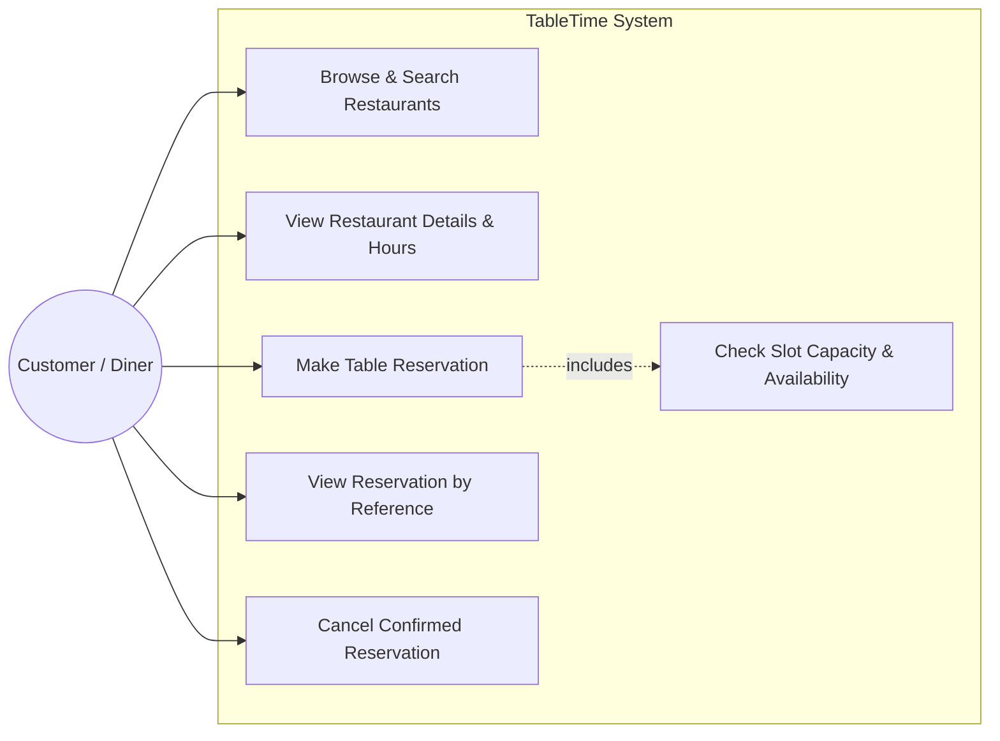

### Diagram 2: Activity Diagram
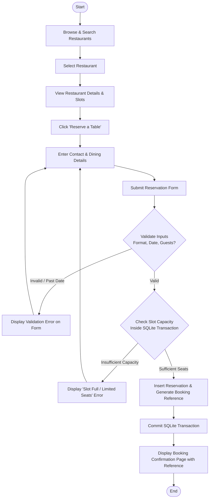

### Diagram 3: Sequence Diagram
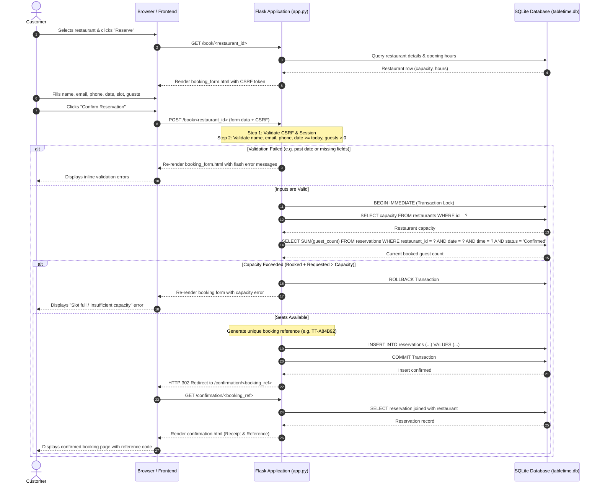

### Diagram 4: Entity-Relationship Diagram (ERD)
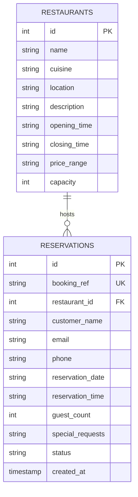

---

## 13. Implementation Details

1. **Transaction-Safe Concurrency Control:**
   In `database.py`, reservation creation initiates a SQLite `BEGIN IMMEDIATE` transaction lock. The query evaluates `SELECT COALESCE(SUM(guest_count), 0) FROM reservations WHERE restaurant_id = ? AND reservation_date = ? AND reservation_time = ? AND status = 'Confirmed'`. If the requested guest count exceeds available seating, the transaction rolls back immediately with an informative message.
2. **Dual-Key Lookup:**
   In `app.py`, looking up reservations requires both `booking_ref` and `email` (`WHERE UPPER(booking_ref) = UPPER(?) AND LOWER(email) = LOWER(?)`), ensuring unauthorized users cannot guess or enumerate references.
3. **Cross-Site Request Forgery (CSRF) Mitigation:**
   A cryptographically secure token (`secrets.token_hex(16)`) is assigned to the session and injected via a Jinja2 context helper. All state-changing `POST` submissions are verified via `secrets.compare_digest(token, expected)`.
4. **Accessible Client-Side Date Restrictions:**
   The browser-side script calculates today's ISO date string and applies `min="today"` to date inputs while enforcing identical validation server-side.

---

## 14. Screenshots of the Running Application

The following screenshots depict the live, running TableTime application executing on localhost port 5000:

| Page / Feature | Screenshot Preview |
| :--- | :--- |
| **Page 1: Home Page**<br/>Branding, hero search, cuisine selector, and featured restaurant cards. | 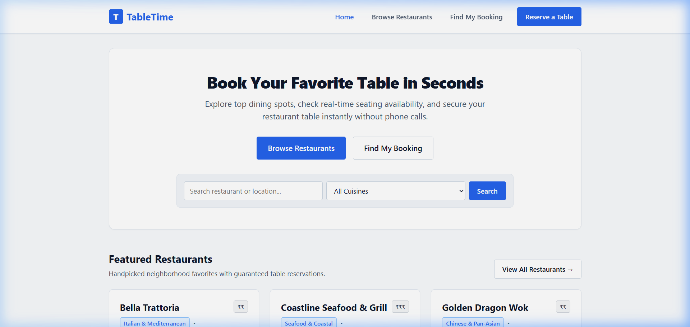 |
| **Page 2: Restaurant Listing**<br/>Responsive directory showing cuisine, price range, hours, and capacity. | 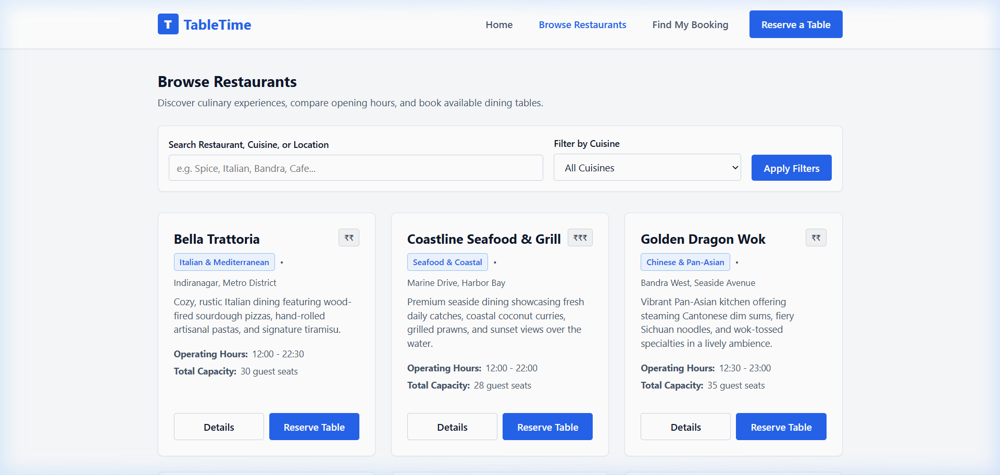 |
| **Search & Filtering in Action**<br/>Live keyword search filtering restaurants with quick reset option. | 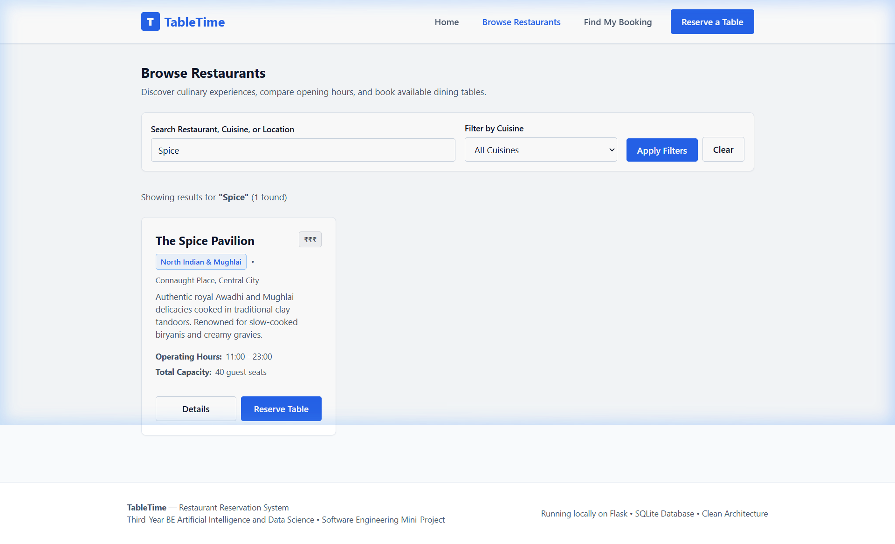 |
| **Page 3: Restaurant Details**<br/>Full venue profile, about section, and calculated 30-minute time slots. | 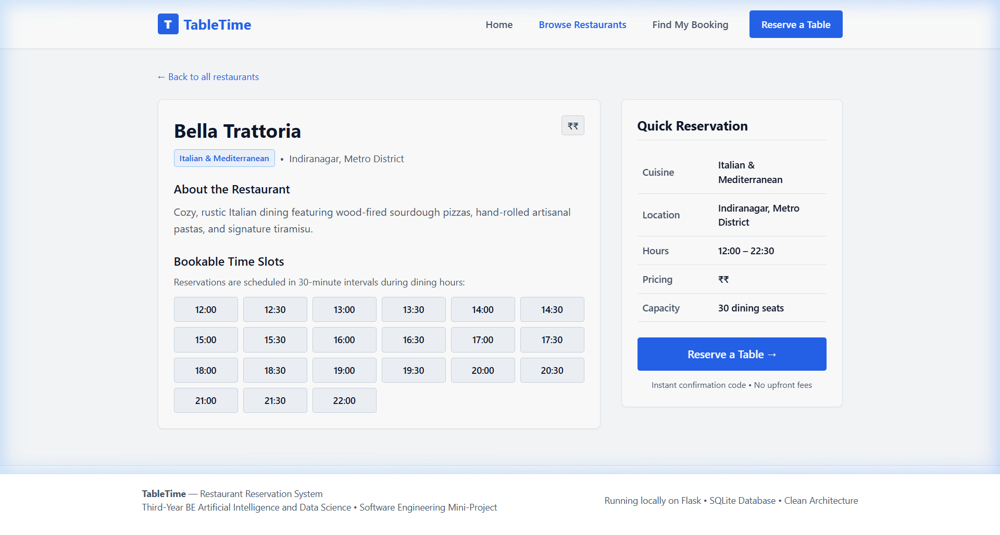 |
| **Page 4: Reservation Form**<br/>Accessible form with contact inputs, party size, and live capacity checking. | 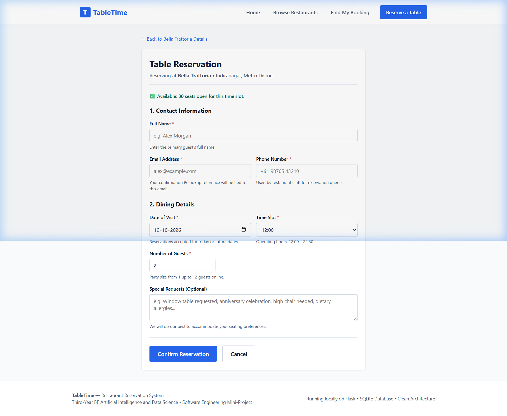 |
| **Page 5: Booking Confirmation**<br/>Generated reference code `TT-BKFFPY`, reservation receipt, and print view. | 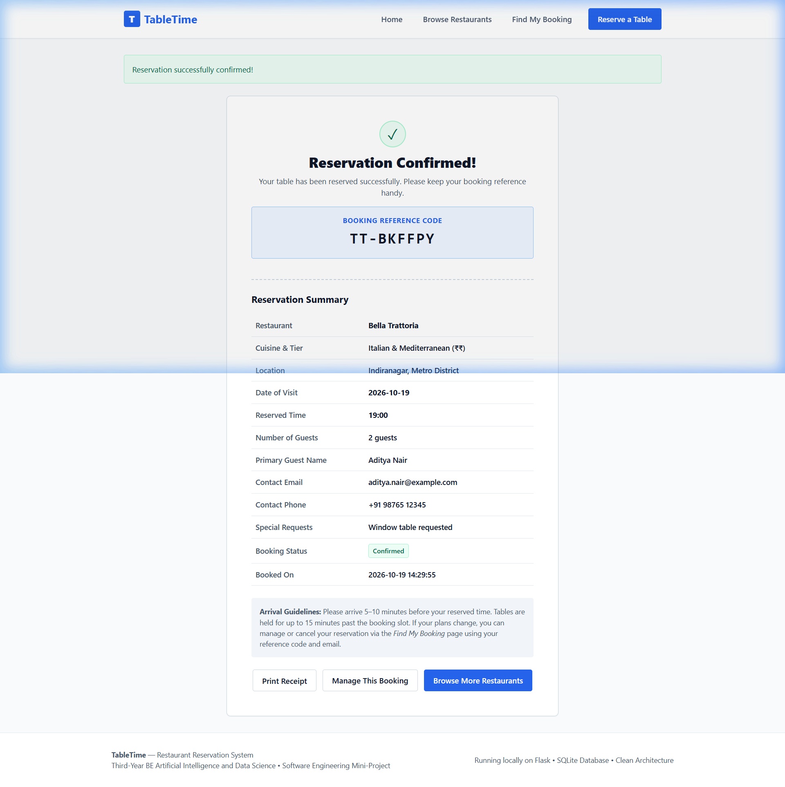 |
| **Page 6: Find My Booking (Confirmed)**<br/>Dual-key lookup displaying active booking with cancel trigger. | 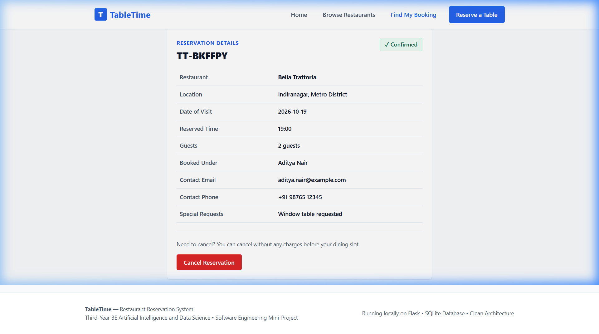 |
| **Page 6: Cancellation Handled**<br/>Status updated to `Cancelled` and capacity released back to restaurant. | 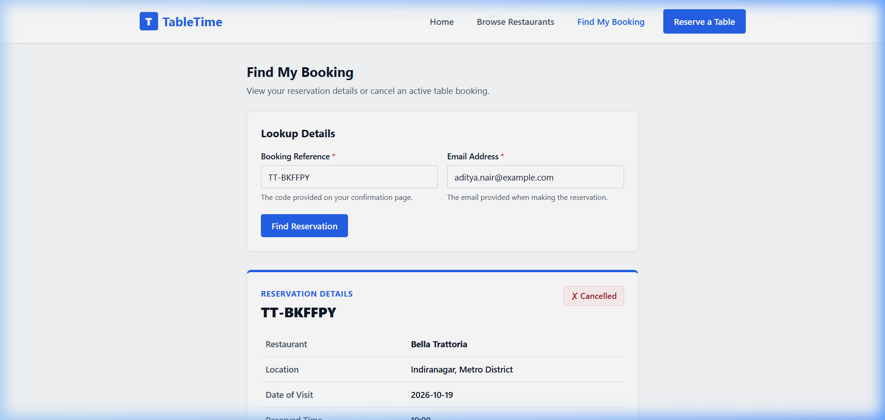 |

---

## 15. Testing Results

All 10 test cases were executed automatically against an isolated test SQLite database using Python `unittest` and `pytest`.

```text
============================= test session starts =============================
platform win32 -- Python 3.12.10, pytest-9.0.2
rootdir: C:\Users\Yash Naik\Downloads\restaurantUI

tests/test_app.py::TableTimeTestCase::test_01_restaurant_listing_loads PASSED [ 10%]
tests/test_app.py::TableTimeTestCase::test_02_restaurant_search_returns_matching PASSED [ 20%]
tests/test_app.py::TableTimeTestCase::test_03_valid_reservation_creation PASSED [ 30%]
tests/test_app.py::TableTimeTestCase::test_04_missing_required_fields_rejected PASSED [ 40%]
tests/test_app.py::TableTimeTestCase::test_05_past_reservation_date_rejected PASSED [ 50%]
tests/test_app.py::TableTimeTestCase::test_06_booking_lookup_success PASSED [ 60%]
tests/test_app.py::TableTimeTestCase::test_07_booking_lookup_fails_incorrect_details PASSED [ 70%]
tests/test_app.py::TableTimeTestCase::test_08_reservation_cancellation_updates_status PASSED [ 80%]
tests/test_app.py::TableTimeTestCase::test_09_over_capacity_booking_rejected PASSED [ 90%]
tests/test_app.py::TableTimeTestCase::test_10_data_persistence_across_restart PASSED [100%]

============================= 10 passed in 3.87s ==============================
```

**Summary:** 10 Total Tests &bull; 10 Passed &bull; 0 Failed &bull; 100% Pass Rate.

---

## 16. Limitations
1. **Local Single-Node Deployment:** The application currently runs on a single host using SQLite, which is ideal for academic demonstrations and small businesses, but requires migration to PostgreSQL for high-scale enterprise distributed hosting.
2. **Simulated Notification Delivery:** Confirmation codes and receipts are generated directly in the browser interface; automated external SMTP email and SMS messaging are not implemented.
3. **Fixed Seating Interval:** Booking durations are set to standard 30-minute arrival intervals rather than dynamic table turnover models based on guest meal durations.

---

## 17. Future Scope
1. **Interactive Floor Plan Visualization:** Implementing interactive SVG canvas floor plans allowing diners to choose specific booth or window table numbers.
2. **SMS & WhatsApp API Alerts:** Integrating Twilio or WhatsApp Business Webhooks to dispatch automated booking reminders 2 hours prior to the dining slot.
3. **Waitlist Queue System:** Allowing guests to join a digital waitlist that automatically triggers an alert if an existing reservation is cancelled.
4. **Restaurant Owner Analytics Dashboard:** Providing managers with peak-hour occupancy analytics, party size trends, and no-show metrics using Matplotlib or Chart.js.

---

## 18. Conclusion
The **TableTime** Restaurant Reservation System successfully demonstrates how core software engineering principles &mdash; requirements engineering, modular architectural design, concurrency control, input sanitization, and automated verification &mdash; can be synthesized to build a practical, accessible, and robust web application. The system operates entirely offline with zero commercial dependencies, guarantees data consistency, prevents overbooking through atomic transactions, and offers an intuitive experience for diners and evaluators alike.
