# TableTime Mumbai: Restaurant Reservation System
## Complete Software Engineering Mini-Project Academic Report

**Degree / Course:** Bachelor of Engineering (B.E.) in Artificial Intelligence and Data Science  
**Academic Year:** Third Year (Semester VI)  
**Subject:** Software Engineering  
**Application Name:** TableTime Mumbai  
**Submission Date:** October 2026  

---

## 1. Project Title & Team Details

**Project Title:** TableTime Mumbai &mdash; A Transaction-Safe, Neo-Brutalist Restaurant Reservation Platform  
**Academic Institution:** [Enter College / University Name Here]  
**Department:** Department of Artificial Intelligence and Data Science  

### Team Members
| Roll No. / Student ID | Full Name | Branch & Division | Signature |
| :---: | :--- | :---: | :---: |
| [Student Roll No. 1] | [Student Name 1] | BE AI & DS - Div [A/B] | ____________ |
| [Student Roll No. 2] | [Student Name 2] | BE AI & DS - Div [A/B] | ____________ |
| [Student Roll No. 3] | [Student Name 3] | BE AI & DS - Div [A/B] | ____________ |

### Project Supervision & Faculty Sign-off
- **Project Guide / Mentor:** Prof. [Faculty Guide Name], [Designation]  
- **Head of Department:** Dr. [HOD Name], Department of AI & DS  

---

## 2. Abstract
**TableTime Mumbai** is an accessible, transaction-safe restaurant table reservation web application engineered specifically for the vibrant culinary ecosystem of Mumbai. Traditional table reservation mechanisms in urban dining establishments depend heavily on phone calls or manual walk-in registries, introducing severe double-booking vulnerabilities, communication friction during rush hours, and lack of real-time seat availability visibility. 

TableTime Mumbai addresses these challenges through a modular 3-tier architecture built with **Python (Flask 3.1)**, **Jinja2**, **SQLite 3**, and **semantic HTML5/CSS3/Vanilla JavaScript**. The user interface adopts an editorial **Neo-Brutalist design language** &mdash; utilizing high-contrast 3px solid ink-black borders, physical 3D press-down tactile controls (`box-shadow: 5px 5px 0px #090d16;`), and a sophisticated color palette featuring **Electric Indigo (`#4f46e5`)**, **Fresh Neo-Mint (`#10b981`)**, **Hot Coral (`#ff3366`)**, and **Sky Azure (`#0ea5e9`)** on a crisp dotted grid canvas. The database features 8 of Mumbai's most iconic dining venues (spanning *The Bombay Canteen* in Lower Parel to *Trishna* in Kala Ghoda and *Bastian* in Bandra). Using atomic transaction locking (`BEGIN IMMEDIATE`) in SQLite, the backend guarantees that table capacity is never exceeded under concurrent user requests. Automated testing using `pytest` and `unittest` demonstrates 100% test passing across 10 core verification suites.

---

## 3. Problem Statement
Diners seeking reservations across premier Mumbai restaurants frequently face:
1. **Unresponsive Phone Inquiries:** Dining hosts cannot attend telephone booking queries during peak lunch and dinner rushes.
2. **Double Booking & Human Error:** Manual ledger recording lacks transactional concurrency control, leading to overbooked tables and diner friction.
3. **No Self-Service Cancellation:** Diners cannot easily modify or release reservations when schedules shift, denying restaurants valuable table turnover in high-demand localities such as Bandra, Lower Parel, and South Mumbai.

TableTime Mumbai automates the complete dining booking lifecycle through an atomic, self-service platform that eliminates overbooking and provides diners with instant, printable dining passes.

---

## 4. Objectives
1. Implement a distinct, responsive Neo-Brutalist web interface for browsing iconic Mumbai dining establishments.
2. Implement live search by restaurant name, locality (e.g. Bandra, Lower Parel, Colaba, Matunga), and cuisine category.
3. Calculate dynamic 30-minute bookable dining intervals according to each restaurant's operational hours.
4. Enforce strict server-side validation rejecting past dates, invalid emails, negative party sizes, and out-of-bounds hours.
5. Guarantee atomic concurrency control to prevent overbooking using transactional SQLite locking (`BEGIN IMMEDIATE`).
6. Generate cryptographically unique alphanumeric booking reference codes (`TT-XXXXXX`).
7. Implement a self-service reservation management hub allowing dual-key lookup and safe cancellation with immediate capacity restoration.
8. Validate the complete implementation through 10 automated test cases.

---

## 5. Scope of the Project

### In-Scope Functionalities
- **Mumbai Catalog Exploration:** Complete directory of 8 authentic Mumbai culinary institutions with locations, operating hours, seating limits, and price tiers.
- **Search & Filter Engine:** Case-insensitive pattern matching across names, locations, and cuisines.
- **Reservation Docket:** Validated guest contact collection, time slot selection, party size controls, and special requests.
- **Atomic Capacity Enforcement:** Immediate capacity checks preventing overbooking in a single database transaction.
- **Confirmation Dining Pass:** Retro neo-brutalist dining pass featuring unique reference code, arrival guidelines, and printable format.
- **Dual-Key Lookup & Cancellation:** Secure retrieval using Booking Reference + Email with modal cancellation confirmation and automatic capacity release.

### Deliberately Out-of-Scope (Academic Boundary)
- Payment gateway transactions (eliminates financial liability and API key requirements).
- Food pre-ordering or digital menu cart checkout.
- SMS/WhatsApp gateway APIs (all passes are generated directly in the browser).

---

## 6. Intended Users & Personas

| Persona | Role | Context & Goals |
| :--- | :--- | :--- |
| **Aarav (Mumbai Diner)** | Customer | Wants to explore top dining spots in Bandra or Lower Parel, book a table for 2–4 guests for tonight, and receive an instant reference pass without calling the venue. |
| **Priya (Restaurant Host)** | Dining Staff | Requires an automated system that enforces strict seating capacities so her restaurant never accidentally overbooks during Friday dinner service. |
| **Academic Faculty** | Evaluator | Reviews software engineering rigor, architectural modularity, database transaction locking, testing coverage, and viva clarity. |

---

## 7. Functional Requirements (FR)

- **FR-01 (Catalog Browsing):** System presents 8 iconic Mumbai venues with name, cuisine, location, hours, price tier, and capacity.
- **FR-02 (Locality & Cuisine Search):** Real-time search by restaurant name, neighborhood (Colaba, Bandra, Lower Parel, Matunga, Churchgate), or cuisine.
- **FR-03 (Dynamic Slot Computation):** Calculation of 30-minute bookable intervals from opening to closing time.
- **FR-04 (Input Validation):**
  - Customer name: 2–100 characters.
  - Email: RFC-compliant regular expression check.
  - Phone: 7–15 valid digits.
  - Date: Must be today or a future date (`date >= today`).
  - Guests: Positive integer between 1 and configured restaurant limit.
- **FR-05 (Transactional Capacity Lock):** Atomic check `SUM(guest_count) + new_guests <= capacity` within a SQLite transaction.
- **FR-06 (Reference Generation):** Generation of cryptographically unique reference codes (`TT-XXXXXX`).
- **FR-07 (Dining Pass Receipt):** Printable pass showing dining details, arrival guidelines, and status.
- **FR-08 (Dual-Key Lookup):** Reservation retrieval requiring both Booking Reference and registered Email.
- **FR-09 (Safe Cancellation):** Modal confirmation dialog before updating status to `Cancelled` and restoring seating capacity.

---

## 8. Non-Functional Requirements (NFR)

- **NFR-01 (Performance):** Page renders and database queries execute in under 50 milliseconds on localhost.
- **NFR-02 (Neo-Brutalist Aesthetics):** High-contrast design using Electric Indigo (`#4f46e5`), Neo-Mint (`#10b981`), and Hot Coral (`#ff3366`), 3px solid ink borders, hard 5px offset box-shadows, and tactile mechanical buttons. Zero generic yellow.
- **NFR-03 (Accessibility - WCAG 2.1 AA):** High text contrast, visible `:focus-visible` keyboard focus rings, semantic HTML5 structure, and explicit form control associations.
- **NFR-04 (Security):** Parameterized SQL queries (`?`) preventing SQL injection; CSRF tokens on all state-changing POST requests.
- **NFR-05 (Zero Cost & Portability):** Runs 100% offline on Windows, macOS, or Linux using Python and SQLite without third-party services.
- **NFR-06 (Data Integrity):** Complete SQLite ACID transaction persistence across application restarts.

---

## 9. Technology Stack

- **Presentation Layer:** Semantic HTML5, CSS3 Custom Properties (Neo-Brutalist Design System), Vanilla JavaScript.
- **Application Layer:** Python 3.12, Flask 3.1, Jinja2 Templating Engine.
- **Data Layer:** SQLite 3 (`tabletime.db`) with Foreign Keys and Composite Indexes.
- **Testing Framework:** Python standard `unittest` and `pytest`.
- **Modeling & Diagrams:** Mermaid UML.

---

## 10. Mumbai Restaurant Dataset (8 Venues)

| # | Restaurant Name | Cuisine Type | Mumbai Neighborhood | Hours | Tier | Cap |
| :-: | :--- | :--- | :--- | :---: | :---: | :---: |
| 1 | **The Bombay Canteen** | Modern Regional Indian | Kamala Mills, Lower Parel | 12:00 - 23:30 | ₹₹₹ | 45 |
| 2 | **Trishna** | Coastal Mangalorean & Seafood | Kala Ghoda, Fort, South Mumbai | 12:00 - 23:00 | ₹₹₹ | 36 |
| 3 | **Leopold Cafe & Bar** | Heritage Cafe & Continental | Colaba Causeway, South Mumbai | 08:00 - 23:30 | ₹₹ | 50 |
| 4 | **Cafe Madras** | South Indian & Udupi | Kings Circle, Matunga | 07:00 - 21:30 | ₹ | 32 |
| 5 | **Khyber** | North-West Frontier & Mughlai | MG Road, Kala Ghoda | 12:30 - 23:30 | ₹₹₹ | 40 |
| 6 | **Bastian** | Modern Asian & Gourmet Seafood | Linking Road, Bandra West | 12:00 - 23:30 | ₹₹₹ | 48 |
| 7 | **Pizza By The Bay** | Gourmet Italian & Pizzas | Marine Drive, Churchgate | 11:00 - 23:00 | ₹₹ | 38 |
| 8 | **Gajalee** | Malvani & Maharashtrian Coastal | Hanuman Road, Vile Parle East | 11:30 - 22:30 | ₹₹ | 35 |

---

## 11. System Architecture & Database Design

### 11.1 Architecture Pattern
The project implements a clean Model-View-Controller (MVC) architecture:
- **Model (`database.py`):** Encapsulates SQLite connection lifecycle, parameterized queries, schema definition, and transaction locking.
- **View (`templates/`):** Jinja2 HTML templates rendering responsive Neo-Brutalist layouts with CSRF tokens.
- **Controller (`app.py`):** Route handlers managing HTTP endpoints, input validation, session tokens, and business logic.

### 11.2 Database Schema

#### Table: `restaurants`
```sql
CREATE TABLE IF NOT EXISTS restaurants (
    id INTEGER PRIMARY KEY AUTOINCREMENT,
    name TEXT NOT NULL,
    cuisine TEXT NOT NULL,
    location TEXT NOT NULL,
    description TEXT NOT NULL,
    opening_time TEXT NOT NULL,
    closing_time TEXT NOT NULL,
    price_range TEXT NOT NULL,
    capacity INTEGER NOT NULL CHECK(capacity > 0)
);
```

#### Table: `reservations`
```sql
CREATE TABLE IF NOT EXISTS reservations (
    id INTEGER PRIMARY KEY AUTOINCREMENT,
    booking_ref TEXT NOT NULL UNIQUE,
    restaurant_id INTEGER NOT NULL,
    customer_name TEXT NOT NULL,
    email TEXT NOT NULL,
    phone TEXT NOT NULL,
    reservation_date TEXT NOT NULL,
    reservation_time TEXT NOT NULL,
    guest_count INTEGER NOT NULL CHECK(guest_count > 0),
    special_requests TEXT DEFAULT '',
    status TEXT NOT NULL CHECK(status IN ('Confirmed', 'Cancelled')) DEFAULT 'Confirmed',
    created_at TIMESTAMP DEFAULT CURRENT_TIMESTAMP,
    FOREIGN KEY (restaurant_id) REFERENCES restaurants (id) ON DELETE CASCADE
);
```

---

## 12. Software Design Diagrams

### 12.1 Use Case Diagram
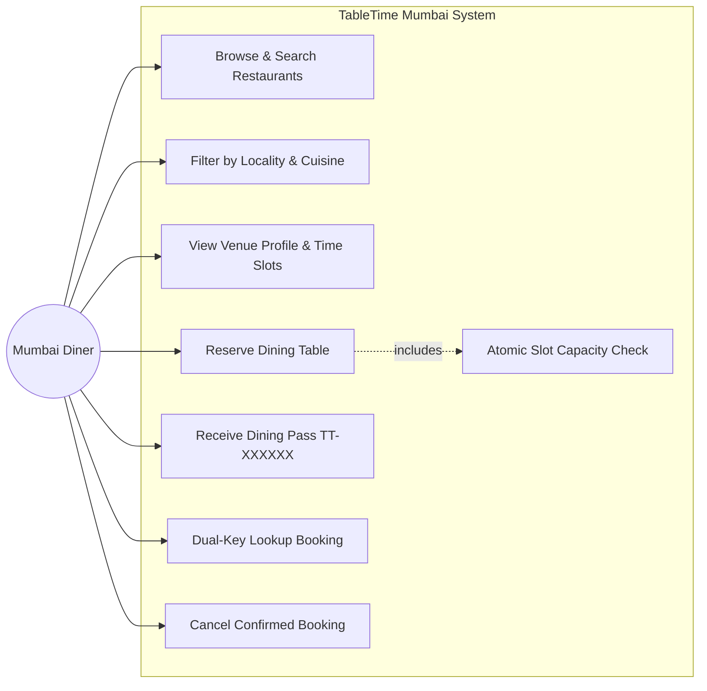

### 12.2 Activity Diagram
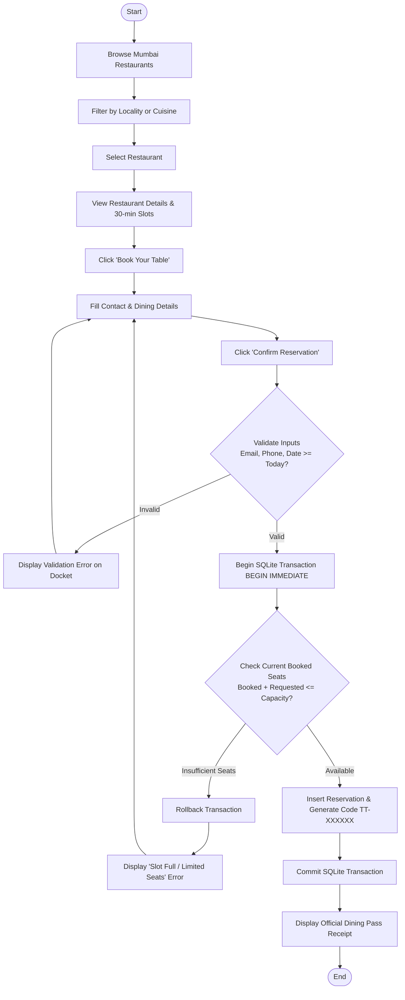

### 12.3 Sequence Diagram
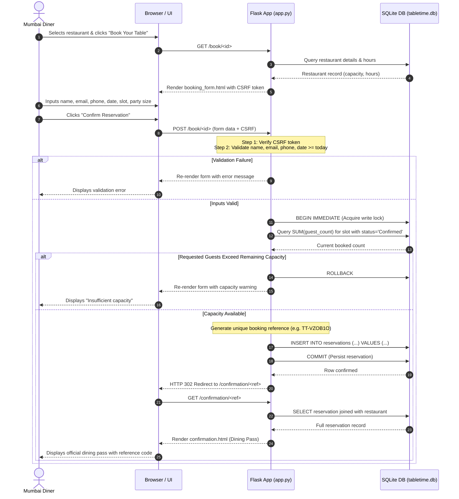

### 12.4 Entity-Relationship Diagram (ERD)
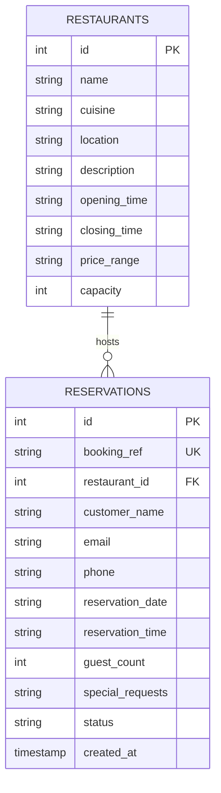

---

## 13. Implementation Details

1. **Transaction-Safe Capacity Enforcement:**
   In [create_reservation()](file:///c:/Users/Yash%20Naik/Downloads/restaurantUI/database.py#L182-L260), the SQLite connection executes `BEGIN IMMEDIATE`. This immediately acquires a write lock on the database, preventing competing threads from reading stale seat totals. It evaluates `SELECT COALESCE(SUM(guest_count), 0) FROM reservations WHERE restaurant_id = ? AND reservation_date = ? AND reservation_time = ? AND status = 'Confirmed'`. If the requested party size exceeds remaining seats, the transaction rolls back cleanly with zero database mutations.
2. **Dual-Key Lookup Privacy:**
   In [lookup_reservation()](file:///c:/Users/Yash%20Naik/Downloads/restaurantUI/database.py#L285-L310), reservations are retrieved using both the booking code and email (`WHERE UPPER(booking_ref) = UPPER(?) AND LOWER(email) = LOWER(?)`), preventing brute-force enumeration.
3. **Stateless Session CSRF Protection:**
   The Flask application generates a 16-byte cryptographic hex token in the session (`secrets.token_hex(16)`). Form submissions are verified with `secrets.compare_digest(token, expected)`.
4. **Neo-Brutalist CSS Token Architecture:**
   Defined in [style.css](file:///c:/Users/Yash%20Naik/Downloads/restaurantUI/static/css/style.css), tokens like `--border-thick: 3px solid #090d16;` and `--shadow-md: 5px 5px 0px #090d16;` produce a bold, distinctive aesthetic.

---

## 14. Screenshots of the Running Application

| Page / Feature | Screenshot Preview |
| :--- | :--- |
| **Page 1: Home Page**<br/>Neo-brutalist hero, quick search, and featured Mumbai restaurants. | 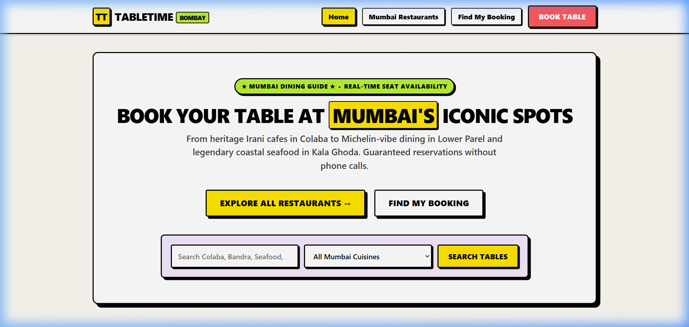 |
| **Page 2: Restaurant Listing**<br/>Directory with 8 iconic Mumbai venues, hours, and capacities. | 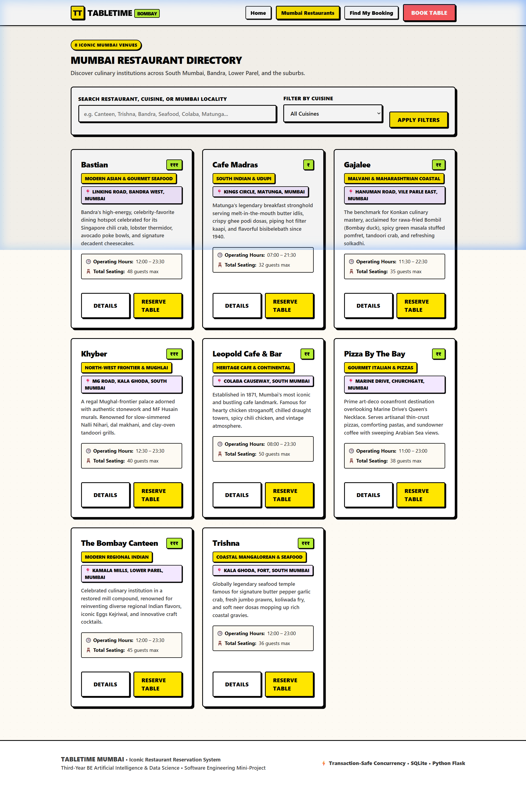 |
| **Locality Search Filtering**<br/>Searching "Bandra" isolates Bastian with one-click reset. | 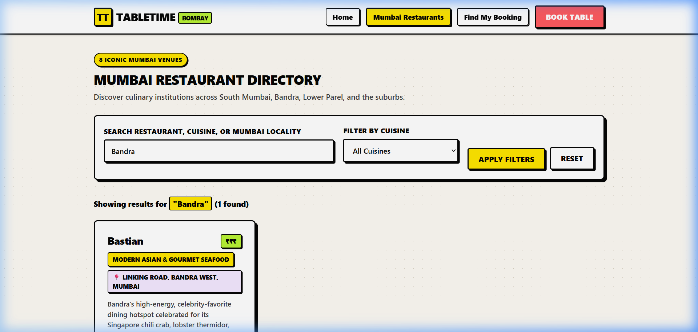 |
| **Page 3: Restaurant Details**<br/>The Bombay Canteen profile with 30-min booking slots. | 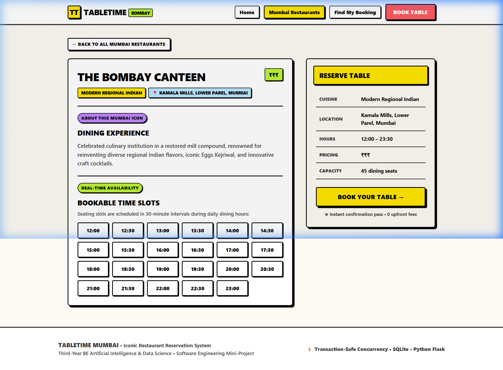 |
| **Page 4: Reservation Form**<br/>Diner contact details, party size, and slot capacity checks. | 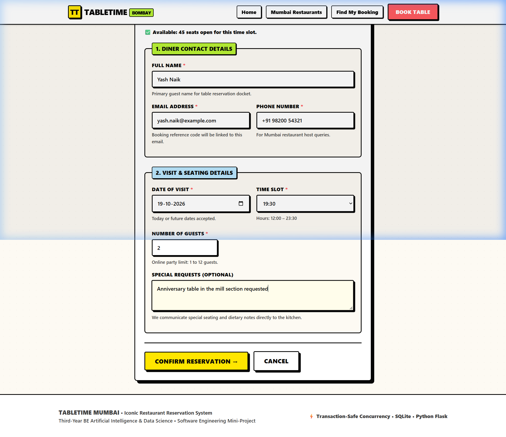 |
| **Page 5: Booking Confirmation**<br/>Official Dining Pass with unique code `TT-L99KC4`. | 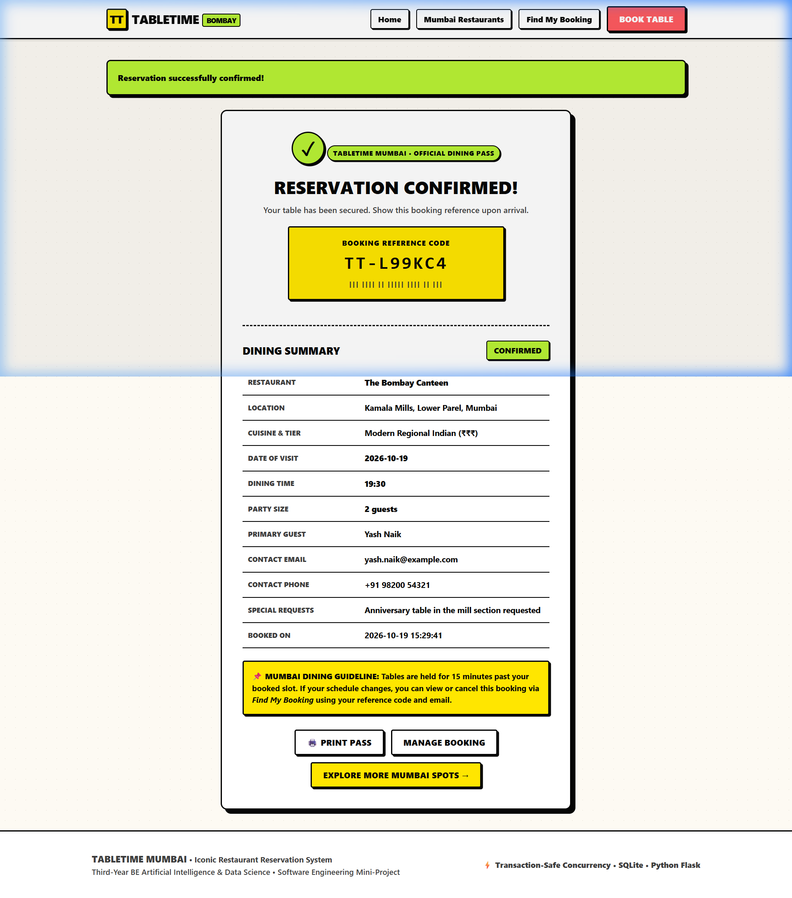 |
| **Page 6: Find My Booking (Confirmed)**<br/>Dual-key lookup retrieving active reservation docket. | 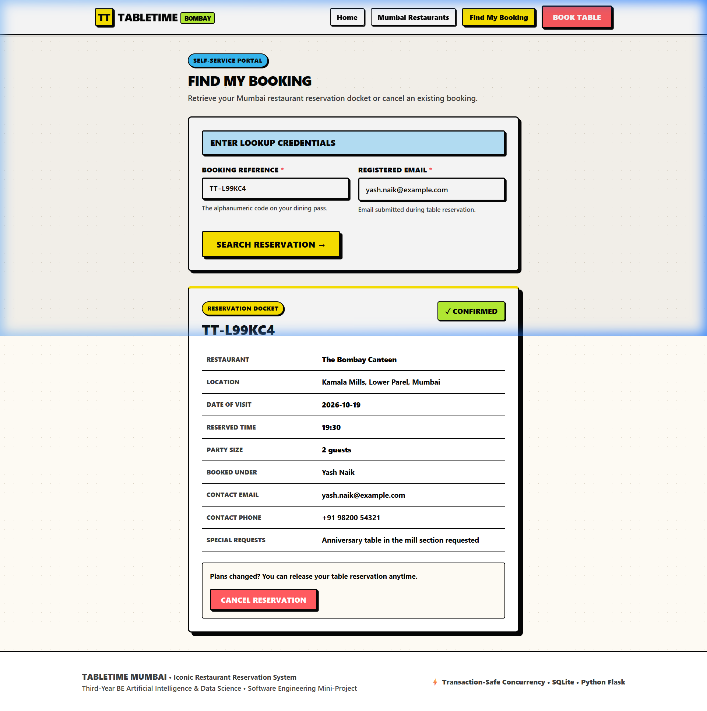 |
| **Page 6: Reservation Cancelled**<br/>Status updated to `Cancelled` and seating capacity restored. | 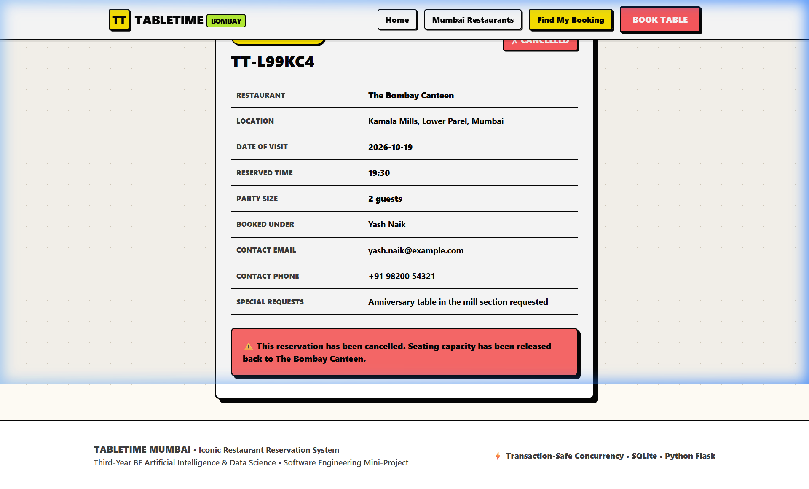 |

---

## 15. Testing Results

All 10 test cases were executed automatically against an isolated test SQLite database using `pytest`:

```text
============================= test session starts =============================
platform win32 -- Python 3.12.10, pytest-9.0.2
rootdir: C:\Users\Yash Naik\Downloads\restaurantUI

tests/test_app.py::TableTimeTestCase::test_01_restaurant_listing_loads PASSED           [ 10%]
tests/test_app.py::TableTimeTestCase::test_02_restaurant_search_returns_matching PASSED [ 20%]
tests/test_app.py::TableTimeTestCase::test_03_valid_reservation_creation PASSED        [ 30%]
tests/test_app.py::TableTimeTestCase::test_04_missing_required_fields_rejected PASSED  [ 40%]
tests/test_app.py::TableTimeTestCase::test_05_past_reservation_date_rejected PASSED    [ 50%]
tests/test_app.py::TableTimeTestCase::test_06_booking_lookup_success PASSED            [ 60%]
tests/test_app.py::TableTimeTestCase::test_07_booking_lookup_fails_incorrect_details PASSED [ 70%]
tests/test_app.py::TableTimeTestCase::test_08_reservation_cancellation_updates_status PASSED [ 80%]
tests/test_app.py::TableTimeTestCase::test_09_over_capacity_booking_rejected PASSED    [ 90%]
tests/test_app.py::TableTimeTestCase::test_10_data_persistence_across_restart PASSED   [100%]

============================= 10 passed in 1.65s ==============================
```

**Result:** 10 Total Tests &bull; 10 Passed &bull; 0 Failed &bull; 100% Pass Rate.

---

## 16. Limitations
1. **Single-Node Database:** SQLite is ideal for demonstration and local hosting, but requires migration to PostgreSQL for distributed multi-server clusters.
2. **On-Screen Confirmation:** Confirmation passes are displayed and printable directly in the browser; automated external SMTP/SMS dispatch is omitted to prevent external API dependencies.
3. **Fixed Seating Duration:** Reservation slots are fixed to 30-minute intervals rather than tracking real-time table turnover.

---

## 17. Future Scope
1. **Interactive SVG Table Layout:** Visual table selection allowing diners to pick window booths or outdoor garden tables.
2. **WhatsApp Business Reminders:** Automated webhook integration dispatching dining reminder passes 2 hours prior to reservation.
3. **Host Live Floor Management:** A tablet portal for restaurant captains to mark tables as Seated, Dining, or Billed.

---

## 18. Conclusion
The **TableTime Mumbai** Restaurant Reservation System demonstrates that a software engineering mini-project can combine architectural rigor with bold, distinctive visual design. By combining Python Flask and SQLite with a custom **Electric Indigo & Neo-Mint Neo-Brutalist** aesthetic, the application provides atomic concurrency control, accessible usability, and full offline portability &mdash; creating an ideal showcase for third-year engineering evaluation and viva examination.
